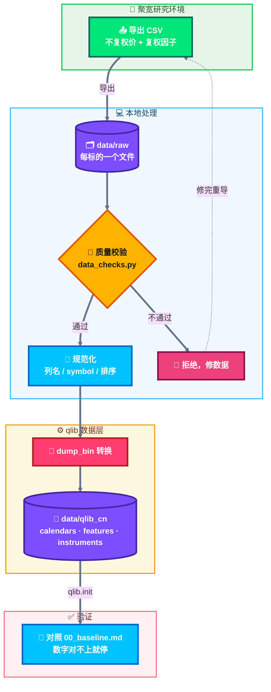
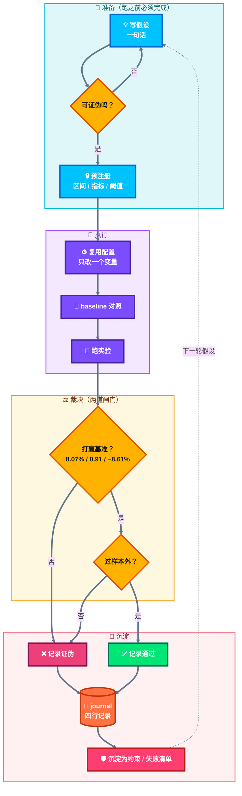

# quant — 量化研究系统

> 这不是一个策略库。策略是消耗品，这份仓库积累的是**研究能力**。
>
> 每次实验必须留下：可复用的配置、可检索的结论、可强制执行的约束。
> 三年后哪怕没有一个策略上线，这个仓库本身也应该是你的资产。

---

## 目录

- [1. 三十秒上手](#1-三十秒上手)
- [2. 系统总览](#2-系统总览)
- [3. 目录职责](#3-目录职责)
- [4. 环境](#4-环境)
- [5. 数据](#5-数据)
- [6. 基线](#6-基线)
- [7. 怎么测](#7-怎么测)
- [8. 一轮实验怎么做](#8-一轮实验怎么做)
- [9. 排障手册](#9-排障手册)
- [10. 路线图](#10-路线图)
- [11. 延伸阅读](#11-延伸阅读)

---

## 1. 三十秒上手

```bash
cd /Users/yaoxiaofeng/code_work/quant

# 跑一遍冻结基准，验证环境和数据都没坏
bash scripts/reproduce_baseline.sh
```

期望输出结尾：

```
'The following are analysis results of the excess return with cost(1day).'
annualized_return  0.080654
information_ratio  0.914486
max_drawdown      -0.086083
```

**看到这三个数，说明环境是好的。**数字对不上，先查环境和数据指纹，不要继续往下做实验。

---

## 2. 系统总览

```mermaid
%%{init: {
  "theme": "base",
  "themeVariables": {
    "fontFamily": "Inter, PingFang SC, Microsoft YaHei, sans-serif",
    "fontSize": "15px",
    "lineColor": "#64748B",
    "background": "#FFFFFF"
  }
}}%%
flowchart LR
  subgraph DATA["📦 数据层"]
    RAW["🗂️ 原始数据<br/><b>聚宽 / 官方快照</b>"]
    BIN[("🧱 bin 存储<br/>原始价 + 独立复权因子")]
  end

  subgraph FEATZ["🧪 特征与模型"]
    FEAT["📐 特征层<br/><b>Alpha158 / 自定义表达式</b>"]
    LABEL["🏷️ 标签层<br/>T+1 买入 T+2 平仓"]
    MDL["🤖 模型层<br/><b>LGBM / XGB / 线性</b>"]
  end

  subgraph BACK["⚙️ 回测与评估"]
    PORT["📊 组合层<br/>TopkDropout 50 / 5"]
    BT["💰 回测层<br/>成本 + 涨跌停"]
    EVAL["📈 评估层<br/>IC / IR / 回撤"]
  end

  subgraph DECIDE["🚦 决策与资产"]
    GATE{"预注册裁决"}
    PASS["✅ 通过"]
    FAIL["❌ 证伪"]
    JNL[("📓 journal<br/>实验档案")]
    JUDGE["🧠 判断力"]
  end

  RAW ==> BIN ==> FEAT
  FEAT ==> LABEL ==> MDL ==> PORT
  PORT ==> BT ==> EVAL ==> GATE
  GATE ==>|达标| PASS
  GATE ==>|未达标| FAIL
  PASS ==> JNL
  FAIL ==> JNL
  JNL ==> JUDGE
  JUDGE -.->|下一轮假设| FEAT

  classDef data fill:#00E676,stroke:#00695C,stroke-width:3px,color:#FFFFFF,font-weight:bold;
  classDef db fill:#7C4DFF,stroke:#4527A0,stroke-width:3px,color:#FFFFFF,font-weight:bold;
  classDef feat fill:#00C2FF,stroke:#0066CC,stroke-width:3px,color:#FFFFFF,font-weight:bold;
  classDef model fill:#00B8D4,stroke:#006064,stroke-width:3px,color:#FFFFFF,font-weight:bold;
  classDef back fill:#FFB300,stroke:#E65100,stroke-width:3px,color:#1A1A1A,font-weight:bold;
  classDef gate fill:#FF3D71,stroke:#B71C1C,stroke-width:3px,color:#FFFFFF,font-weight:bold;
  classDef asset fill:#FF7043,stroke:#BF360C,stroke-width:3px,color:#FFFFFF,font-weight:bold;
  classDef loss fill:#EC407A,stroke:#880E4F,stroke-width:3px,color:#FFFFFF,font-weight:bold;

  class RAW data;
  class BIN,JNL db;
  class FEAT,LABEL feat;
  class MDL model;
  class PORT,BT,EVAL back;
  class GATE gate;
  class PASS,JUDGE asset;
  class FAIL loss;

  style DATA fill:#E8F5E9,stroke:#00C853,stroke-width:2px,color:#1B5E20
  style FEATZ fill:#E0F7FA,stroke:#00BCD4,stroke-width:2px,color:#006064
  style BACK fill:#FFF8E1,stroke:#F59E0B,stroke-width:2px,color:#78350F
  style DECIDE fill:#FFF1F2,stroke:#FB7185,stroke-width:2px,color:#881337
```



三个要点：

1. **左边是机器，右边是资产。** 左边可以换框架、换模型；右边（journal）不能换，它是你唯一会增值的东西。
2. **`I{预注册裁决}` 是整条链路的闸门。** 没有预先写死的通过阈值，右边产出的全是噪音。
3. **`M → C` 这条回流线**，就是“积累”的物理形态：上一轮的结论影响下一轮的假设。没有这条线，你就是原地打转。

---

## 3. 目录职责

```
quant/
├── .venv/                      Python 3.11 虚拟环境（不入库）
├── configs/                    实验配置，每个实验一个 yaml
│   ├── baseline/               冻结基准配置，只读
│   └── exp/                    进行中的实验
├── constraints/                强制约束（错误 → 断言）
│   └── data_checks.py          数据质量校验
├── data/
│   ├── raw/                    原始导出数据（不入库）
│   └── qlib_cn/                转换后的 bin 数据（不入库）
├── features/                   自定义因子表达式库
├── journal/                    实验档案 ← 最重要的目录
│   └── 00_baseline.md          冻结基准
├── docs/                       教程与判断标准
│   ├── methodology.md          四条判据 / purged CV / PBO / 框架更换条款
│   ├── qlib-walkthrough.md     模块巡游：8 站逐个跑，看懂每层在干什么
│   └── external-resources.md   第三方 qlib 仓库清单 + 判断标准
├── reports/                    单次运行的产物（不入库）
├── scripts/
│   ├── walkthrough.py          模块巡游脚本（8 个 stage）
│   ├── reproduce_baseline.sh   一键复现基准
│   └── run_official_tests.sh   跑官方测试套件
├── vendor/
│   └── qlib/                   qlib v0.9.8 源码（editable 安装）
├── requirements.lock.txt       198 个依赖的完整锁定
└── README.md
```

**判断一个目录重不重要的标准**：删掉它你会不会心疼三年。
- `journal/`、`constraints/`、`features/` → 会，所以它们进版本控制
- `data/`、`reports/`、`.venv/` → 不会（可重建），所以 `.gitignore` 掉

> 注意 `vendor/qlib` 是源码目录。**不要在这个目录内部运行任何 Python 代码**，否则 `import qlib` 会命中未编译的源码，报 `No module named 'qlib.data._libs.rolling'`。

---

## 4. 环境

### 4.1 已安装的版本（不要随意升级）

| 组件 | 版本 | 为什么锁这个版本 |
|---|---|---|
| Python | 3.11.17 | qlib 支持 3.8–3.12，3.14 装不上 |
| qlib | **v0.9.8**（`54355232`） | 源码 editable 安装，与 `examples/` 同版本 |
| lightgbm | 4.7.0 | 需要 `libomp` |
| mlflow | **2.11.3** | **必须 <3.x**，3.x 默认禁用 file store，qlib 直接报错 |
| numpy | **1.26.4** | 必须 <2 |
| pandas | 2.1.4 | |

### 4.2 使用方式

```bash
# 方式一：显式调用（推荐，无需激活）
.venv/bin/python your_script.py
.venv/bin/qrun your_config.yaml

# 方式二：激活
source .venv/bin/activate
```

### 4.3 如果环境崩了怎么重建

```bash
# 1. Python 3.11
brew install python@3.11
/opt/homebrew/opt/python@3.11/bin/python3.11 -m venv .venv

# 2. 依赖
.venv/bin/pip install -r requirements.lock.txt

# 3. qlib 源码安装（关键：不能用 pip install pyqlib，会和 examples 版本错配）
.venv/bin/pip install --no-deps --no-build-isolation -e vendor/qlib

# 4. 验证
bash scripts/reproduce_baseline.sh
```

---

## 5. 数据

### 5.1 当前有什么

官方示例数据，已下载：

| 项 | 值 |
|---|---|
| 路径 | `~/.qlib/qlib_data/cn_data` |
| 体积 | 510 MB |
| 标的 | 3875 只 |
| 交易日历 | 1999-11-10 ~ **2020-09-25**（4943 个交易日） |
| 来源 | Yahoo Finance |
| 股票池文件 | `instruments/all.txt`、`csi100/300/500.txt` |

**关键限制：数据只到 2020-09-25。**

这意味着你现在**做不了真正的样本外验证**——2021 年至今完全没有数据。而 2020 年之前这段，正是 Alpha158 被无数人反复筛选过的区间。

**所以接入自己的数据不是可选项，是必须项。**

### 5.2 数据导入流程



### 5.3 CSV 目标格式

qlib 的 `dump_bin` 要求**每只股票一个 CSV 文件**，文件名即代码，列为：

```csv
date,open,high,low,close,volume,factor
2020-01-02,12.34,12.56,12.30,12.50,12345678,1.0
2020-01-03,12.50,12.70,12.45,12.68,11223344,1.0
```

约定：

| 列 | 含义 | 来源（聚宽） |
|---|---|---|
| `date` | 交易日 | — |
| `open/high/low/close` | **不复权**原始价 | `get_price(fq='none')` |
| `volume` | 成交量（股） | `get_price` 的 `volume` |
| `factor` | 复权因子 | 后复权价 ÷ 原始价，或直接取复权因子 |

**为什么价格必须是不复权 + 独立 factor：**

前复权价格会随每次除权整体重算。你今天导出的数据，明年再导，历史价格全变，所有回测结论作废。这是最容易让“积累”清零的一件事，且发生时不会有任何报错。

> 待确认（需要你回答）：聚宽的 `get_price(fq='post')` 能否直接拿到后复权价？`get_extras` 能否拿到复权因子？这决定 `factor` 是直接取还是算出来。

### 5.4 symbol 格式转换

| 聚宽 | qlib |
|---|---|
| `600000.XSHG` | `SH600000` |
| `000001.XSHE` | `SZ000001` |

### 5.5 instruments 文件格式

`instruments/csi300.txt`，Tab 分隔，每行一个标的及其有效区间：

```
SH600000	2005-01-04	2020-09-25
SZ000001	1991-04-03	2020-09-25
```

**这里的日期区间是防幸存者偏差的关键。** 用今天的成分股回测 2015 年，是标准未来函数。

---

## 6. 基线

冻结基准的完整档案在 [`journal/00_baseline.md`](journal/00_baseline.md)，摘要：

| 指标 | 值 |
|---|---|
| 含成本超额年化 | **8.07%** |
| 信息比率 | 0.91 |
| 最大回撤 | −8.61% |
| IC / RankIC | 0.0468 / 0.0490 |

**任何新实验要被认定“有改进”，必须同时满足：**

1. 含成本年化 > 8.07%
2. IR > 0.91
3. 最大回撤不劣于 −8.61%
4. 在样本外区间上成立
5. 记录了试错次数，给出多重检验校正后的显著性

只满足 1–3 而不满足 4–5 的结果，**一律视为噪音，不写进 journal**。

---

## 7. 怎么测

### 7.1 官方测试套件（验证框架本身没坏）

```bash
bash scripts/run_official_tests.sh
```

期望：

```
3 passed
├─ test_0_train       训练 + 断言 IC/RankIC ≥ 0
├─ test_1_backtest    断言含成本年化 ≥ 5%
└─ test_2_expmanager  实验记录与 uri
```

这个测试验证的是**框架的完整性**，不是你的策略。它挂了，说明环境坏了。

> 脚本细节：官方测试必须复制到仓库外运行，因为 `vendor/qlib` 在 `sys.path` 里会遮蔽已安装包。另外官方测试有个 `lstrip("file:")` 的 bug 会在当前目录建假目录，脚本会自动清理。

### 7.2 复现基准（验证数据没坏）

```bash
bash scripts/reproduce_baseline.sh
```

脚本会先校验数据指纹（`calendars/day.txt` 和 `instruments/csi300.txt` 的 md5），指纹不符直接退出。

**数据变了，基准就失效，禁止用它做对照。**

### 7.3 数据质量校验（验证新数据没坏）

```bash
.venv/bin/python -c "
import sys; sys.path.insert(0, '.')
import pandas as pd
from constraints.data_checks import run_all
df = pd.read_csv('data/raw/SH600000.csv')
run_all(df)          # 不通过直接抛异常
print('通过')
"
```

校验项：列完整性、空值、OHLC 关系、成交量非负、重复行、复权因子跳变、覆盖天数、日期是否在日历内。

**每踩一个新坑，就往 `data_checks.py` 加一条检查。** 这是“错误变成约束”的地方。

---

## 8. 一轮实验怎么做



五个动作，一个都不能跳：

| 步骤 | 产出 | 位置 |
|---|---|---|
| 1. 写假设 | 一句话，可证伪 | `journal/NN_xxx.md` 开头 |
| 2. 预注册 | 区间、指标、阈值，**跑之前写死** | 同上 |
| 3. 跑实验 | 一个 yaml，只改一个变量 | `configs/exp/` |
| 4. 裁决 | 通过 / 证伪 + 原因 | 同上 |
| 5. 沉淀 | 新增检查项 / 失败清单条目 | `constraints/` 或 journal |

**第 5 步是分水岭。** 大多数人跳过它，所以做十年也在原地打转。

### 实验配置模板

复制 `vendor/qlib/examples/benchmarks/LightGBM/workflow_config_lightgbm_Alpha158.yaml` 到 `configs/exp/`，只改需要变的那一项，其余保持一致。**配置即实验记录**，git 会保存每次改动。

---

## 9. 排障手册

| 现象 | 原因 | 解决 |
|---|---|---|
| `No module named 'qlib.data._libs.rolling'` | 在 `vendor/qlib` 内部运行，命中了未编译源码 | 换到仓库根目录运行 |
| `MlflowException: filesystem tracking backend ... maintenance mode` | mlflow 3.x 默认禁用 file store | 降级 `mlflow==2.11.3` |
| `ModuleNotFoundError: No module named 'pkg_resources'` | setuptools ≥81 移除了该模块 | `pip install "setuptools<81"` |
| `Library not loaded: @rpath/libomp.dylib` | macOS 缺 OpenMP | `brew install libomp` |
| `TypeError: load_object() got unexpected keyword 'trusted'` | 代码与 tests/examples 版本错配 | 源码 editable 装 v0.9.8 |
| `pip install` 报 `SystemExit: 1` | IDE 注入了 `PYTHONPATH` shim | `env -u PYTHONPATH pip install ...` |
| 结果每次都不一样 | 数据或配置没锁 | 跑 `reproduce_baseline.sh` 查指纹 |

---

## 10. 路线图

```mermaid
%%{init: {
  "theme": "base",
  "themeVariables": {
    "fontFamily": "Inter, PingFang SC, Microsoft YaHei, sans-serif",
    "fontSize": "15px",
    "lineColor": "#64748B",
    "background": "#FFFFFF"
  }
}}%%
flowchart LR
  subgraph DONE["✅ 已完成"]
    A["🏗️ 环境 + 冻结基准<br/><b>8.07% / 0.91 / −8.61%</b><br/>三次运行一致"]
  end

  subgraph NEXT["🎯 近期（地基）"]
    B["🗄️ 接聚宽数据<br/>补齐 2021 至今"]
    C["📜 PROTOCOL.md<br/>锁定样本外区间"]
  end

  subgraph MID["🔬 中期（研究）"]
    D["📐 Alpha158 因子归因<br/>哪类因子真有效"]
    E["🧪 自定义因子<br/>持续迭代"]
  end

  subgraph LONG["🚀 长期（扩展）"]
    F["🤖 多模型对比<br/>LGBM / XGB / 线性"]
    G["📓 journal 月更<br/>失败清单累积"]
  end

  A ==> B ==> C ==> D ==> E ==> F ==> G

  classDef done fill:#00E676,stroke:#00695C,stroke-width:3px,color:#FFFFFF,font-weight:bold;
  classDef soon fill:#FFB300,stroke:#E65100,stroke-width:3px,color:#1A1A1A,font-weight:bold;
  classDef mid fill:#00C2FF,stroke:#0066CC,stroke-width:3px,color:#FFFFFF,font-weight:bold;
  classDef long fill:#7C4DFF,stroke:#4527A0,stroke-width:3px,color:#FFFFFF,font-weight:bold;

  class A done;
  class B,C soon;
  class D,E mid;
  class F,G long;

  style DONE fill:#E8F5E9,stroke:#00C853,stroke-width:2px,color:#1B5E20
  style NEXT fill:#FFF8E1,stroke:#F59E0B,stroke-width:2px,color:#78350F
  style MID fill:#E0F7FA,stroke:#00BCD4,stroke-width:2px,color:#006064
  style LONG fill:#F3E8FF,stroke:#A855F7,stroke-width:2px,color:#5B21B6
```



| 阶段 | 目标 | 完成标志 |
|---|---|---|
| ✅ 当前 | 建立可重复基准 | 三次运行结果一致 |
| 下一步 | 接入自有数据 | 2021 年后有完整数据 |
| 之后 | 立规范 | `PROTOCOL.md` 定稿，样本外锁定 |
| 之后 | 因子归因 | 输出“哪类因子有效”的表 |
| 长期 | 持续迭代 | journal 每月有新条目 |

---

## 附：这个项目的三条铁律

1. **没有预注册的实验，结果不算数。** 看完结果再定阈值，等于自欺。
2. **样本外只碰一次。** 一旦看过，那个区间就作废了。
3. **失败记录比成功记录值钱。** 成功可能是运气，失败排除了一个方向。

---

## 11. 延伸阅读

| 文档 | 内容 | 什么时候看 |
|---|---|---|
| [`docs/methodology.md`](docs/methodology.md) | **判断标准**：四条判据、purged CV、PBO/DSR、框架选型与更换条款 | 每次实验前，或想换框架时 |
| [`docs/qlib-walkthrough.md`](docs/qlib-walkthrough.md) | **模块巡游**：8 个 stage 逐个跑通，看懂每层在干什么 | 刚开始，或忘了某层怎么用 |
| [`docs/external-resources.md`](docs/external-resources.md) | 值得看的 qlib 第三方仓库 + 五条判断标准 | 想找参考实现时 |
| [`journal/00_baseline.md`](journal/00_baseline.md) | 冻结基准档案（数字、指纹、偏差、晋升标准） | 每次实验前后 |

配套脚本：

| 脚本 | 用途 | 耗时 |
|---|---|---|
| `.venv/bin/python scripts/walkthrough.py all` | 模块巡游，8 站全跑 | ~3 分钟 |
| `.venv/bin/python scripts/walkthrough.py <stage>` | 单跑某一站 | 10s–1min |
| `bash scripts/reproduce_baseline.sh` | 复现基准，校验环境与数据 | ~2 分钟 |
| `bash scripts/run_official_tests.sh` | 跑官方测试套件 | ~70 秒 |
