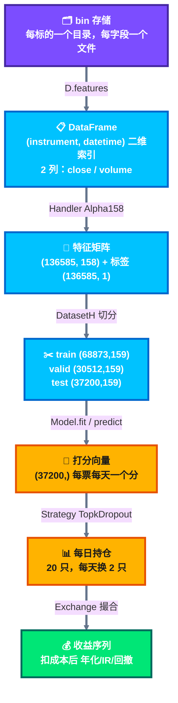

# Qlib 模块巡游：跑一遍就懂

> 这份文档解决的问题：**看懂 qlib 每一层在干什么，而不是把代码丢给 AI 翻译。**
>
> 配套脚本：`scripts/walkthrough.py`，8 个 stage，每个 10 秒到 1 分钟。
> 全部跑完约 3 分钟，你就知道 `journal/00_baseline.md` 里那三个数字是从哪来的。

---

## 0. 一句话理解 qlib

**它是一条装配线，8 个零件，每个零件只干一件事。**

```
原始价格 ──► 特征矩阵 ──► 模型打分 ──► 排名 ──► 持仓 ──► 扣成本后收益
   (1)         (3)          (5)        (6)      (7)        (7)
```

数据在每一站的"形状"都在变，**看懂形状变化，就懂了整个框架**。

---

## 1. 八块零件

```mermaid
%%{init: {
  "theme": "base",
  "themeVariables": {
    "fontFamily": "Inter, PingFang SC, Microsoft YaHei, sans-serif",
    "fontSize": "15px",
    "lineColor": "#64748B",
    "background": "#FFFFFF"
  }
}}%%
flowchart LR
  subgraph S1["📦 第 1-2 站 数据与因子"]
    A["🗂️ D<br/>日历/股票池/取数"]
    B["📐 表达式引擎<br/>一行写一个因子"]
  end

  subgraph S2["🧪 第 3-4 站 特征与切分"]
    C["🏷️ Handler<br/>特征矩阵 + 标签"]
    D2["✂️ Dataset<br/>按时间硬切三段"]
  end

  subgraph S3["🤖 第 5-6 站 训练与记录"]
    E["🎯 Model<br/>只负责打分"]
    F["💾 Record<br/>存预测 / 算 IC"]
  end

  subgraph S4["💰 第 7-8 站 组合与编排"]
    G["📊 Strategy<br/>信号转持仓"]
    H["⚙️ Exchange<br/>成本/涨跌停/撮合"]
    I["📜 qrun<br/>yaml 串起全部"]
  end

  A ==> B ==> C ==> D2 ==> E ==> F ==> G ==> H
  I -.->|声明式编排| A

  classDef s1 fill:#00E676,stroke:#00695C,stroke-width:3px,color:#FFFFFF,font-weight:bold;
  classDef s2 fill:#00C2FF,stroke:#0066CC,stroke-width:3px,color:#FFFFFF,font-weight:bold;
  classDef s3 fill:#7C4DFF,stroke:#4527A0,stroke-width:3px,color:#FFFFFF,font-weight:bold;
  classDef s4 fill:#FFB300,stroke:#E65100,stroke-width:3px,color:#1A1A1A,font-weight:bold;
  classDef runner fill:#FF3D71,stroke:#B71C1C,stroke-width:3px,color:#FFFFFF,font-weight:bold;

  class A,B s1;
  class C,D2 s2;
  class E,F s3;
  class G,H s4;
  class I runner;

  style S1 fill:#E8F5E9,stroke:#00C853,stroke-width:2px,color:#1B5E20
  style S2 fill:#E0F7FA,stroke:#00BCD4,stroke-width:2px,color:#006064
  style S3 fill:#F3E8FF,stroke:#A855F7,stroke-width:2px,color:#5B21B6
  style S4 fill:#FFF8E1,stroke:#F59E0B,stroke-width:2px,color:#78350F
```



---

## 2. 怎么跑

```bash
cd /Users/yaoxiaofeng/quant_code/qlib-study

# 一次跑一个模块（推荐，逐个消化）
.venv/bin/python scripts/walkthrough.py data
.venv/bin/python scripts/walkthrough.py expression
.venv/bin/python scripts/walkthrough.py handler
.venv/bin/python scripts/walkthrough.py dataset
.venv/bin/python scripts/walkthrough.py model
.venv/bin/python scripts/walkthrough.py signal
.venv/bin/python scripts/walkthrough.py backtest
.venv/bin/python scripts/walkthrough.py workflow

# 或者一口气全跑（约 3 分钟）
.venv/bin/python scripts/walkthrough.py all
```

看全部 stage 名字：`.venv/bin/python scripts/walkthrough.py --help`

---

## 3. 逐站拆解

### 第 1 站：数据层 `D`

**解决什么问题**：把一堆 bin 文件包装成统一接口，你不用管文件怎么存。

```bash
.venv/bin/python scripts/walkthrough.py data
```

真实输出：

```
D.calendar 交易日历：10 天，2020-08-24 ~ 2020-09-04
D.instruments('csi300') 成分数：300，前 5 个：['SH600000', 'SH600004', 'SH600009', 'SH600010', 'SH600011']

D.features 单字段取数（索引是 instrument + datetime，二维）：
                         $close     $volume
instrument datetime
SH600000   2020-09-01  8.056056  68886360.0
           2020-09-02  7.969937  72534136.0
```

**要记住的一点**：返回值永远是 `(instrument, datetime)` 二维索引。

你自己写量化代码时 80% 的隐蔽 bug——`shift` 方向错、跨股票串行、截面没按日期分组——都来自破坏了这个结构。qlib 用类型强制你遵守。

---

### 第 2 站：表达式引擎

**解决什么问题**：因子用一行公式写，不用写 for 循环。

```bash
.venv/bin/python scripts/walkthrough.py expression
```

真实输出：

```
  $close                                 收盘价                8.0561, 7.9699, 7.9230, 7.8838
  Ref($close, 1)                         昨收（严格滞后 1 期）       8.1109, 8.0561, 7.9699, 7.9230
  Mean($close, 5)                        5 日均线              8.1156, 8.0858, 8.0498, 7.9887
  Std($close, 20)                        20 日波动             0.0962, 0.1109, 0.1271, 0.1443
  ($close-Ref($close,1))/Ref($close,1)   日收益率               -0.0068, -0.0107, -0.0059, -0.0049
  Corr($close, $volume, 10)              量价 10 日相关性         -0.2743, -0.3557, -0.2298, 0.0424
```

**要注意**：`Ref($close, 1)` 自带滞后语义，**写不出零滞后的版本**。手写 `df.shift(1)` 很容易漏，而且漏了不报错，只是回测变好看。

你以后加因子，是往配置里加一行表达式，不是加一个 py 文件。

---

### 第 3 站：Handler

**解决什么问题**：把原始价量变成模型能吃的特征矩阵和标签。

```bash
.venv/bin/python scripts/walkthrough.py handler
```

真实输出：

```
特征矩阵 shape = (136585, 158)   （行=股票×日期，列=158 个因子）
标签向量 shape = (136585, 1)
特征列前 8 个：['KMID', 'KLEN', 'KMID2', 'KUP', 'KUP2', 'KLOW', 'KLOW2', 'KSFT']
标签列：['LABEL0']

耗时 9.3s
```

**这一站干了三件事**：

1. 算 158 个因子（K 线形态、动量、波动、量价相关）
2. 算标签：`Ref($close,-2)/Ref($close,-1)-1` —— T+1 开盘附近买、T+2 收盘平，符合 A 股 T+1
3. 标准化：用 `fit_start_time ~ fit_end_time` 这段的统计量做 Z-Score

第 3 件事是**防泄漏的关键**。你在这个 stage 的代码里能看到：

```python
fit_start_time=FIT_START,
fit_end_time=FIT_END,    # 只到训练期末，不是数据末尾
```

如果这里写成数据末尾，验证集和测试集的信息就漏进特征了，回测立刻变好看，而且不会报错。

---

### 第 4 站：Dataset

**解决什么问题**：按时间切成 train / valid / test。

```bash
.venv/bin/python scripts/walkthrough.py dataset
```

真实输出：

```
  train  shape=(68873, 159)  日期 2015-01-05 ~ 2015-12-31
  valid  shape=(30512, 159)  日期 2016-01-04 ~ 2016-06-30
  test   shape=(37200, 159)  日期 2016-07-01 ~ 2016-12-30
```

159 = 158 个特征 + 1 个标签。

**硬切，没有随机打乱。** 随机 K-Fold 在时序上必然泄漏，因为标签之间有时间重叠。

> **坑（0.9.8 版本变更）**：网上大量教程写 `ds.prepare()`，在 qlib 0.9.8 上会直接报 `TypeError: prepare() missing 1 required positional argument: 'segments'`。
> 新版本必须传 segment 名字：`ds.prepare("train")`。
> **这就是为什么网上的 qlib 教程大量不可用——它们对应的是 2021 年的 API。**

---

### 第 5 站：模型

**解决什么问题**：把特征矩阵映射成一个打分。

```bash
.venv/bin/python scripts/walkthrough.py model
```

真实输出：

```
[8]	train's l2: 0.969252	valid's l2: 0.99305

训练完成，耗时 0.6s
预测结果 shape = (37200,)（test 段每只股票每天一个分数）
datetime    instrument
2016-07-01  SH600000     -0.005510
            SH600008     -0.014181
            SH600009      0.042409
```

**要记住**：模型只做一件事——打分。

它不知道成本、不知道涨跌停、不知道组合权重。这就是为什么换模型（LGBM → XGB → 线性 → Transformer）时，上下游完全不用动。

---

### 第 6 站：实验记录

**解决什么问题**：把预测、IC、模型存下来，三个月后还能查。

```bash
.venv/bin/python scripts/walkthrough.py signal
```

真实输出：

```
SignalRecord 存下预测：shape=(37200, 1)
{'IC': 0.0106, 'ICIR': 0.0895, 'Rank IC': 0.0420, 'Rank ICIR': 0.3697}

产物目录：/Users/yaoxiaofeng/quant_code/qlib-study/mlruns/186852094365204698/c1469164ec0c...
```

**这一站是整个系统的价值所在。**

没有它，你三个月后无法回答"上次那个结论是怎么来的"。有了它，每个实验的预测值、IC、模型文件、参数全都落盘，可回查、可对比。

---

### 第 7 站：回测

**解决什么问题**：把打分变成持仓，再算上成本和涨跌停。

```bash
.venv/bin/python scripts/walkthrough.py backtest
```

真实输出：

```
回测结果（含成本）：
                       risk
mean              -0.000434
std                0.004543
annualized_return -0.103364
information_ratio -1.474979
max_drawdown      -0.080044
```

这一站由两个零件组成：

| 零件 | 决定什么 | 配置项 |
|---|---|---|
| `Strategy`（TopkDropout） | 买哪些、买多少、换多少 | `topk=20, n_drop=2` |
| `Exchange` | 能不能成交、扣多少钱 | `limit_threshold=0.095`、`open_cost/close_cost` |

**你在 baseline 里看到的 8.07%，就是这两块的乘积。**

---

### 第 8 站：编排

```bash
.venv/bin/python scripts/walkthrough.py workflow
```

它不跑代码，只打印一张对照表——**yaml 的每一段对应你刚跑过的哪个 stage**：

| YAML 字段 | 对应 stage |
|---|---|
| `qlib_init` | 1 数据层 |
| `task.dataset.handler` | 3 Handler |
| `task.dataset.segments` | 4 时间切分 |
| `task.model` | 5 模型 |
| `record.SignalRecord` | 6 存预测 |
| `record.SigAnaRecord` | 6 算 IC |
| `record.PortAnaRecord` | 7 回测 |
| `port_analysis_config` | 7 策略 + 交易所 |

**结论：`qrun` 不是黑盒。** 它就是按顺序实例化这些类，把你的 yaml 翻译成函数调用。

所以改 yaml = 改实验，不用改代码。这就是能持续迭代的原因。

---

## 4. 数据形状流水线（最重要的一张表）



**这张表建议背下来**：第 4 站之后，问题一旦出现，先看形状对不对，90% 的 bug 在形状上就能定位。

---

## 5. 为什么巡游结果是负的

你会看到 `annualized_return -0.103364`，而 baseline 是 `+8.07%`。

**这是正常的，不是跑错了。**

| 项 | 巡游 | baseline |
|---|---|---|
| 训练区间 | 2015 一年 | 2008–2014 七年 |
| 回测区间 | 2016 下半年 | 2017–2020 三年半 |
| 持仓 | topk=20 | topk=50 |
| 用途 | **看模块怎么接** | **当基准** |

巡游用极小样本，只为了让你快速看清数据怎么流动。**它的数字没有任何参考价值。**

要数字，跑 `scripts/reproduce_baseline.sh`。

---

## 6. 自检：跑完之后，你应该能回答

1. `D.features` 返回的索引是什么？为什么这个索引能防住跨股票串行的 bug？
2. Alpha158 的标签为什么是 `Ref($close,-2)/Ref($close,-1)-1`，而不是简单的次日收益？
3. `fit_start_time / fit_end_time` 如果写成数据末尾，会发生什么？会报错吗？
4. 模型输出的 shape 从 `(37200, 159)` 变成 `(37200,)`，中间丢了什么？去哪了？
5. 想换 XGBoost，要改哪几个文件？（答案：只改 yaml 里 `task.model` 那一块）
6. 回测收益为负，可能是哪两个零件的锅？

答不上来的，回去把对应的 stage 再跑一遍。

---

## 7. 调试技巧

**看某个中间结果**，不用改框架，直接在脚本里插一段：

```python
from qlib.data import D
import qlib
qlib.init(provider_uri="~/.qlib/qlib_data/cn_data", region="cn")

# 随便试一个表达式，立刻看结果
df = D.features(["SH600000"], ["Corr($close,$volume,20)"], start_time="2020-08-01", end_time="2020-09-01")
print(df.tail())
```

**试新因子**就是这么试——一行表达式，立刻看数值分布，确认合理了再进模型。

**看历史实验**：

```bash
cd /Users/yaoxiaofeng/quant_code/qlib-study
.venv/bin/mlflow ui --backend-store-uri ./mlruns
```

浏览器打开后能看到每次实验的参数、指标、产物文件。

---

## 8. 下一步

跑完这 8 站，你已经具备两件事：

1. 知道每个模块的边界在哪（改哪一块不影响其他块）
2. 知道数据在每一站的形状（能用形状定位 bug）

接下来才是有价值的部分：**把 Alpha158 拆开做因子归因**——这 158 个因子，哪几类真的在贡献，哪几类纯噪音。

那才是往 `journal/` 里填东西的开始。
